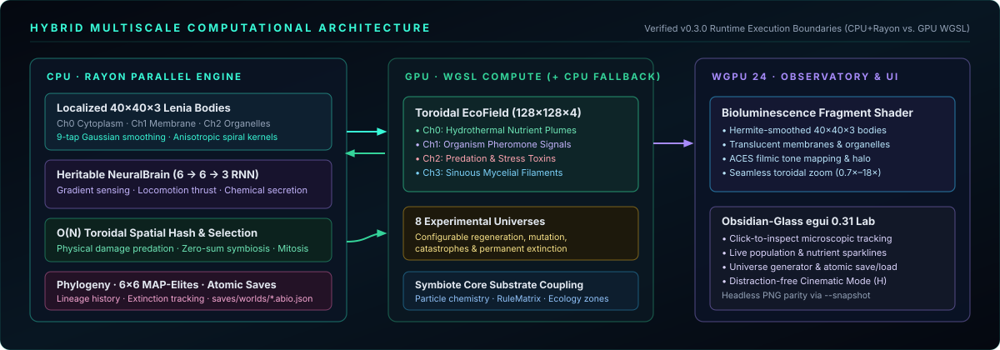
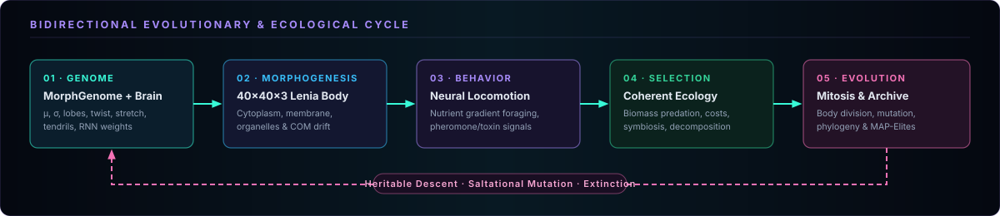

<div align="center">


# Life without biology. Evolution without boundaries.

**An experimental artificial biosphere where mathematics becomes morphology, genomes become behavior, and ecosystems develop their own history.**<br>
Built in native Rust, Rayon, `wgpu` 24 / WGSL, and `egui` 0.31 — uniting continuous cellular automata with adaptive ecological selection.

[](https://github.com/ShamelesAbyss/Symbiote-Abiogenesis/releases/tag/v0.3.2)
[](https://github.com/ShamelesAbyss/Symbiote-Abiogenesis/actions/workflows/ci.yml)
[](Cargo.toml)
[](src/convergence/gpu_compute.rs)
[](src/convergence/observatory.rs)
[](LICENSE)

[](https://github.com/ShamelesAbyss/Symbiote-Abiogenesis/releases/download/v0.3.2/symbiote-abiogenesis-v0.3.2-windows-x86_64.exe)
[](docs/ARCHITECTURE.md)
[](src/convergence/experiments.rs)
[](src/convergence/persistence.rs)

[**Overview**](#overview) · [**Download**](#download) · [**Observatory**](#observatory) · [**Subsystems**](#subsystems) · [**Universes**](#universes) · [**Architecture**](#architecture) · [**Benchmarks**](#benchmarks) · [**Roadmap**](#roadmap)

</div>

> [!NOTE]
> **Scientific Scope & Transparency:** Abiogenesis is an experimental artificial-life research environment, not a conventional game. Organism shapes arise from simulated `40×40×3` continuous cellular fields (`LeniaBody`) coupled to heritable genomes and a toroidal `128×128×4` reaction-diffusion environment (`EcoField`). In v0.3.0, `EcoField` compute and observatory visualization run on the GPU via `wgpu`/WGSL, while localized cellular bodies, `NeuralBrain` controllers, and spatial hashing execute in parallel on the CPU via Rayon. See [docs/ARCHITECTURE.md](docs/ARCHITECTURE.md) and [docs/RESEARCH.md](docs/RESEARCH.md) for the exact distinction between engineered mechanisms and emergent dynamics.

---

<a id="overview"></a>
## Overview

**Symbiote: Abiogenesis** began as a mathematical convergence of two upstream projects — [Symbiote](https://github.com/ShamelesAbyss/Symbiote)'s evolutionary particle ecology and [Primordia](https://github.com/ShamelesAbyss/Primordia)'s continuous Lenia cellular automata — and has evolved into an independent computational biosphere.

Every organism in Abiogenesis is not a decorative sprite or point particle. Each creature possesses:
- A live **`40×40×3` continuous cellular body** (Cytoplasm, Translucent Membrane, Internal Organelles) governed by heritable anisotropic Lenia kernels and 9-tap diffusive smoothing.
- A heritable **`NeuralBrain`** recurrent controller (`6 → 6 → 3`) sensing local nutrient gradients, toxins, pheromones, and internal energy.
- **Coherent metabolic and ecological physics** where predation inflicts actual cellular damage, symbiosis transfers real energy, swimming and membrane upkeep carry metabolic costs, and death recycles biomass back into the surrounding chemical field.

---

<a id="download"></a>
## Download & Quick Start

### Windows Native Executable (Recommended)
1. Download **[`symbiote-abiogenesis-v0.3.2-windows-x86_64.exe`](https://github.com/ShamelesAbyss/Symbiote-Abiogenesis/releases/download/v0.3.2/symbiote-abiogenesis-v0.3.2-windows-x86_64.exe)** from the [v0.3.2 Release](https://github.com/ShamelesAbyss/Symbiote-Abiogenesis/releases/tag/v0.3.2).
2. Double-click the executable to launch the native **Abiogenesis Research Laboratory** immediately.
3. Click any organism to track and inspect its cellular body and genome, scroll to zoom from planetary to microscopic scale, or press **`H`** for distraction-free **Cinematic Mode**.

### Build from Source (Windows / Linux · Rust 1.80+)
```bash
git clone https://github.com/ShamelesAbyss/Symbiote-Abiogenesis.git
cd Symbiote-Abiogenesis

# Launch the native GPU Research Laboratory (default)
cargo run --release

# Force CPU-Rayon backend for EcoField compute
cargo run --release -- --cpu

# Run the 4-part quantitative validation suite
cargo run --release -- --experiment

# Pure CPU build (zero GPU or windowing dependencies)
cargo run --release --no-default-features -- --experiment --cpu

# Capture headless 1440×810 PNG renders directly from the simulation
cargo run --release -- --snapshot

# Launch the preserved classic Symbiote terminal simulation
cargo run --release -- --legacy-tui
```

> Full controls, save paths (`saves/worlds/*.abio.json`), and system requirements are documented in [docs/USER_GUIDE.md](docs/USER_GUIDE.md).

---

<a id="observatory"></a>
## Visual Observatory

Renders below were captured directly from the live v0.3.0 simulation state via the shader-parity headless renderer (`--snapshot`, `1440×810` RGB PNG):

| Deep Abyssal Ecosystem (1.8× Seamless Toroidal Field) | Microscopic Continuous Cellular Bodies (5.8× Inspection) |
| :---: | :---: |
|  |  |
| *Near-black abyssal void with sinuous mycelial filaments, marine-snow bokeh, and distinct evolved morphologies roaming freely without boundary clumping.* | *Silky-smooth `40×40×3` bioluminescent Lenia bodies displaying translucent refractive membranes, hollow subsurface cytoplasm, and differentiated internal structures.* |

Inside the native executable, this real-time WGSL viewport is framed by a custom **obsidian-glass `egui` 0.31 Research Laboratory** featuring universe generation, live population & nutrient sparklines, click-to-inspect microscopic tracking, 3-channel cellular density bars, MAP-Elites discovery listings, atomic save/load, and a toggleable **Cinematic Mode (`H`)**.

---

<a id="subsystems"></a>
## Subsystem Identities

| Subsystem | Accent | Implemented Role in v0.3.0 | Source |
| :--- | :---: | :--- | :--- |
| **MORPHOGENESIS** | `#38F9D7` | Localized `40×40×3` 3-channel diffusive Lenia bodies (Cytoplasm, Membrane, Organelles), spiral anisotropic kernels, velocity-aligned headings, mitotic division | [`lenia_body.rs`](src/convergence/lenia_body.rs) |
| **NEURAL SYSTEMS** | `#A78BFA` | Heritable `6 → 6 → 3` recurrent `NeuralBrain` sensing local nutrients, gradients, toxins, pheromones, and energy to drive thrust & secretion | [`lenia_body.rs`](src/convergence/lenia_body.rs) |
| **ECOLOGY** | `#34D399` | `128×128×4` toroidal reaction-diffusion `EcoField`, coherent predation damage, zero-sum symbiosis, kinetic/membrane costs, decomposition recycling | [`eco_field.rs`](src/convergence/eco_field.rs), [`engine.rs`](src/convergence/engine.rs) |
| **PHYLOGENY** | `#F472B6` | Founding lineage records, parent-child ancestry, saltational macro-mutations, generation depth, and permanent extinction tracking | [`phylogeny.rs`](src/convergence/phylogeny.rs) |
| **UNIVERSES** | `#FBBF24` | 8 distinct experimental environments with configurable nutrient regen, metabolic costs, mutation rates, catastrophes, and abiogenesis toggles | [`universes.rs`](src/convergence/universes.rs) |
| **DISCOVERY ARCHIVE** | `#C084FC` | `6×6` MAP-Elites Quality-Diversity archive automatically cataloging high-fitness organisms across elongation × morphological complexity niches | [`phylogeny.rs`](src/convergence/phylogeny.rs) |
| **OBSERVATORY** | `#38BDF8` | Native `winit` 0.30 + `wgpu` 24 + `egui` 0.31 laboratory, ACES filmic bioluminescent shader, sparklines, organism tracking, Cinematic Mode | [`observatory.rs`](src/convergence/observatory.rs) |
| **PERSISTENCE** | `#60A5FA` | Versioned (`v2`) atomic write-to-temp-then-rename world snapshots preserving full cellular fields, genomes, brains, chemistry, and phylogeny | [`persistence.rs`](src/convergence/persistence.rs) |
| **COMPUTE ENGINE** | `#2DD4BF` | Rust 2021 + Rayon parallel organism stepping, $O(N)$ toroidal spatial hash grid, `wgpu` 24 WGSL `EcoField` compute, and pure-CPU fallback | [`gpu_compute.rs`](src/convergence/gpu_compute.rs), [`engine.rs`](src/convergence/engine.rs) |

---

<a id="universes"></a>
## Experimental Universes

Each universe preset in [`universes.rs`](src/convergence/universes.rs) alters genuine physical, chemical, and evolutionary rules:

| Universe | Initial / Cap | Nutrient Regen | Metabolic Cost | Mutation | Abiogenesis | Special Dynamics |
| :--- | :---: | :---: | :---: | :---: | :---: | :--- |
| **Primordial Ocean** | 32 / 72 | `1.25×` | `0.95×` | `0.055` | Enabled | Balanced, spacious abyssal ocean for observing distinct morphologies |
| **Abyssal Biosphere** | 36 / 220 | `0.55×` | `1.25×` | `0.050` | **Disabled** | Severe resource scarcity rewarding lean metabolic efficiency |
| **Genesis** | 14 / 256 | `1.05×` | `0.95×` | `0.075` | **Disabled** | Minimal founder seeding; extinction is permanent |
| **Alien Garden** | 44 / 280 | `1.45×` | `0.85×` | `0.045` | Enabled | Lush nutrient upwelling & elevated spiral/branching morphology |
| **Evolutionary Arena** | 64 / 320 | `0.95×` | `1.15×` | `0.065` | **Disabled** | Dense competitive arena driving heavy predation and lineage pruning |
| **Extinction Protocol** | 56 / 256 | `1.10×` | `1.05×` | `0.080` | **Disabled** | Periodic global toxin catastrophes every `450` ticks |
| **Mathematical Anomaly** | 42 / 240 | `1.15×` | `0.95×` | `0.115` | Enabled | Extreme spiral kernel twist (`+1.40`) and heightened mutation |
| **Sandbox Laboratory** | 40 / 256 | `1.00×` | `1.00×` | `0.055` | Enabled | Neutral baseline for controlled experimentation |

---

<a id="architecture"></a>
## Computational & Evolutionary Architecture



<br/>



---

<a id="benchmarks"></a>
## Verified Telemetry & Benchmarks (v0.3.0)

Measured in `--release` on **Intel Core i9-14900HX · NVIDIA GeForce RTX 4070 Laptop GPU (8 GB VRAM) · 32 GB RAM · Windows 11**:

| Validation Suite (`--experiment` / `cargo test`) | Verified Measurement |
| :--- | :--- |
| **Morphological Stability (Exp 1)** | **200 / 200 steps** persistence across all 6 founding tribes (`40×40×3` continuous fields, zero NaN/Inf) |
| **Bidirectional Nutrient Coupling (Exp 2)** | Nutrient-rich (`0.90`) sustains higher mass (`0.178`) & membrane (`0.405`) than starved + toxin (`0.02`, mass `0.171`) |
| **Ecological Selection & Discovery (Exp 3)** | 500 ticks in *Evolutionary Arena*: **245 births**, **39 deaths**, **2,181 predations**, **Gen 4**, **17/36 MAP-Elites niches** |
| **Simulation Throughput (Exp 4)** | **47.8 ticks/sec** at **256 simultaneous `40×40×3` organisms** (`GPU-Compute + Rayon`), **9.9 MB** continuous field buffers |
| **Automated Unit Tests (`cargo test`)** | **3 / 3 passing** (numerical stability & predation damage, mutation bounds & crossover, atomic persistence round-trip) |
| **GitHub Actions CI** | **Green** across Ubuntu CPU-only, Windows CPU-only, and Windows GPU + Observatory release builds |

See [docs/BENCHMARKS.md](docs/BENCHMARKS.md) for historical comparisons across v0.1.0–v0.3.0 and hardware details.

---

<a id="roadmap"></a>
## Scientific Roadmap & Documentation

- **Implemented (v0.1.0–v0.3.0)**: `40×40×3` multichannel Lenia bodies, `NeuralBrain`, toroidal `EcoField` (WGSL + Rayon), coherent predation/symbiosis, 8 universes, `6×6` MAP-Elites archive, atomic `v2` persistence, and the obsidian-glass `egui` Research Laboratory.
- **Experimental**: `MorphGenome::crossover` (unit-tested, awaiting live contact-triggered sexual recombination).
- **Next Milestones**: Batched GPU-resident Lenia compute shader (scaling to 1,000+ organisms), interactive graphical Phylogenetic Tree viewer, and multi-slot world manager.

### Supporting Documentation
- [ARCHITECTURE.md](docs/ARCHITECTURE.md) · [RESEARCH.md](docs/RESEARCH.md) · [BENCHMARKS.md](docs/BENCHMARKS.md) · [USER_GUIDE.md](docs/USER_GUIDE.md)
- [ROADMAP.md](ROADMAP.md) · [CHANGELOG.md](CHANGELOG.md) · [AGENTS.md](AGENTS.md) · [HANDOFF.md](HANDOFF.md)

---

## Upstream Attribution & License

- **Symbiote: Abiogenesis** is released under the [MIT License](LICENSE).
- Continuous cellular automata kernel shells and Gaussian growth formulations are adapted with attribution from **Lenia** (Bert Chan, 2018, MIT License) and **Primordia** (ShamelesAbyss). Full license texts are preserved in [THIRD_PARTY_LICENSES.md](THIRD_PARTY_LICENSES.md).
- Original upstream repositories ([Symbiote](https://github.com/ShamelesAbyss/Symbiote), [Primordia](https://github.com/ShamelesAbyss/Primordia), and documentation reference [Hydra](https://github.com/ShamelesAbyss/Hydra)) remain completely unmodified.
