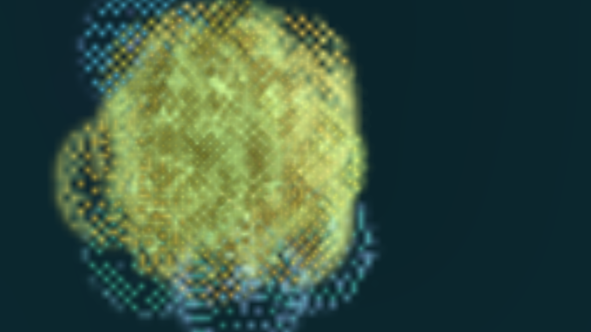
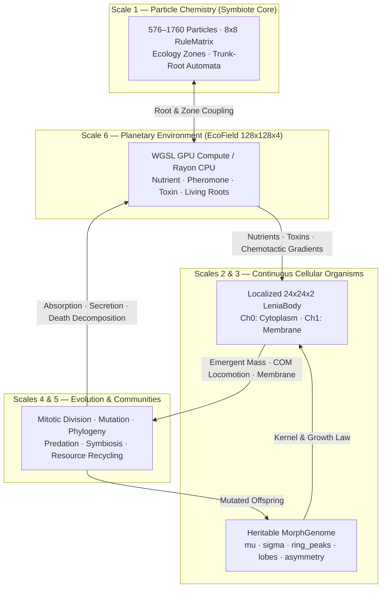

<div align="center">

# ◉ SYMBIOTE: PROJECT ABIOGENESIS

**Where Continuous Cellular Morphology Meets Adaptive Artificial Ecology**

[](https://github.com/ShamelesAbyss/Symbiote-Abiogenesis/actions/workflows/ci.yml)
[](LICENSE)
[](https://www.rust-lang.org/)
[](https://wgpu.rs/)

*A unified multiscale artificial-life ecosystem fusing [Symbiote](https://github.com/ShamelesAbyss/Symbiote)'s evolutionary particle chemistry and ecological food webs with [Primordia](https://github.com/ShamelesAbyss/Primordia)'s continuous Lenia cellular automata.*

</div>

---

## Visual Observatory

Actual renders captured directly from the live simulation (`--snapshot` / `--observatory`):

| Ecosystem-Wide Planetary Field (1.0×) | Microscopic Continuous Cellular Bodies (5.5×) |
| :---: | :---: |
|  |  |
| *Reaction-diffusion nutrient currents, living sapphire root networks, pheromone halos, and evolving Lenia organisms.* | *Localized `24×24×2` continuous cytoplasm & refractive membrane fields with bioluminescent lineage coloration.* |

---

## Multiscale Architecture

Instead of simulating an entire empty world at maximum cellular resolution, **Symbiote: Project Abiogenesis** couples a planetary-scale continuous reaction-diffusion substrate with localized high-resolution Lenia cellular bodies owned by individual evolving organisms:



---

## Validated Experimental Benchmarks (`--experiment`)

Measured in `--release` on **Intel Core i9-14900HX + NVIDIA RTX 4070 Laptop GPU (8 GB VRAM)**:

| Experiment | Metric | Result |
| :--- | :--- | :--- |
| **1. Morphological Stability** | 200-step persistence across all 6 tribes | **200/200 steps** for all 6 tribes (`final_mass` 0.180–0.191) |
| **2. Bidirectional Coupling** | Nutrient-rich (`0.90`) vs. Nutrient-poor (`0.02`) mass | `+0.012` mass delta (`0.189` vs `0.177`), shifted COM & membrane |
| **3. Multi-Gen Evolution** | 600 ticks across `Calm → Hunger → Bloom` | 36 → 96 organisms, 60+ births, **Gen 4–5**, heritable drift in `mu` & `asymmetry` |
| **4. Throughput & Memory** | 200 ticks @ 96 organisms | **193.2 ticks/s** (GPU+Rayon) · **159.2 ticks/s** (CPU-Rayon) · **1.38 MB** total field memory |

---

## Installation & Quick Start

### Prebuilt Windows Release
Download the latest `symbiote-abiogenesis-windows-x86_64.exe` from [GitHub Releases](https://github.com/ShamelesAbyss/Symbiote-Abiogenesis/releases).

### Build from Source (Rust 1.80+)
```bash
git clone https://github.com/ShamelesAbyss/Symbiote-Abiogenesis.git
cd Symbiote-Abiogenesis

# Interactive GPU Bioluminescent Observatory (default features: gpu + observatory)
cargo run --release -- --observatory

# Run the 4-part Experimental Validation Suite (GPU + Rayon)
cargo run --release -- --experiment

# Force CPU-Rayon fallback
cargo run --release -- --experiment --cpu

# Pure CPU build (no GPU / windowing dependencies)
cargo run --release --no-default-features -- --experiment

# Capture high-resolution PNG screenshots directly from the simulation
cargo run --release -- --snapshot

# Launch the classic Symbiote terminal observatory (100% preserved)
cargo run --release
```

### Observatory Controls
| Input | Action |
| :--- | :--- |
| **Mouse Wheel** / `+` / `-` | Seamless zoom (`0.6×` planetary → `18.0×` microscopic) |
| **Arrow Keys** / `W A S D` | Pan camera across the ecosystem |
| `Space` | Pause / resume simulation |
| `0` | Reset camera to planetary overview |
| `Q` / `Esc` | Quit observatory |

---

## Upstream Attribution & Licensing

- **Symbiote: Project Abiogenesis** is licensed under the [MIT License](LICENSE).
- Continuous cellular automata kernel shells and Gaussian growth formulations are adapted with attribution from **Lenia** (Bert Chan, 2018, MIT License) and **Primordia** (ShamelesAbyss). See [THIRD_PARTY_LICENSES.md](THIRD_PARTY_LICENSES.md) for full license texts.
