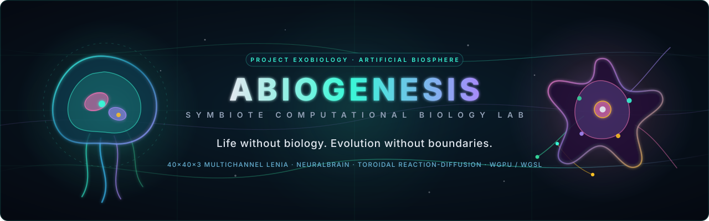
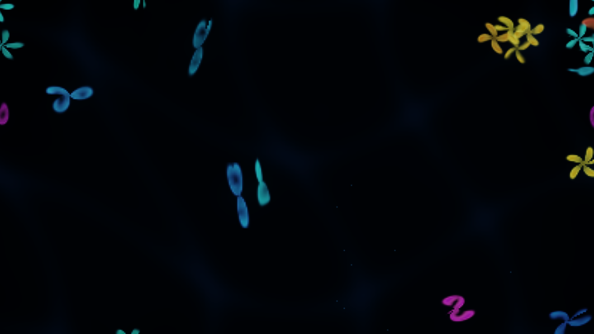
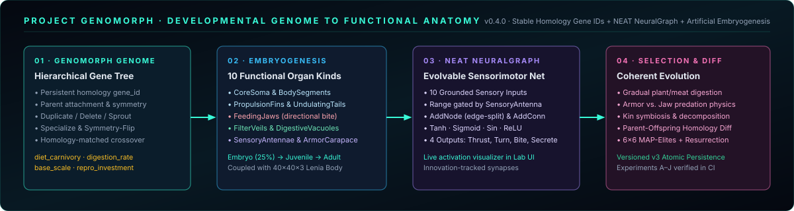

<div align="center">



# Life inherits. Life adapts. Life becomes.

**An experimental artificial biosphere where developmental genetics becomes procedural anatomy, evolving neural graphs become behavior, and ecosystems write their own evolutionary history.**<br>
Built in native Rust, Rayon, `wgpu` 24 / WGSL, and `egui` 0.31 — uniting procedural organ biology, NEAT-inspired neural evolution, and continuous multichannel Lenia cellular automata.

[](https://github.com/ShamelesAbyss/Symbiote-Abiogenesis/releases/tag/v0.5.0)
[](https://github.com/ShamelesAbyss/Symbiote-Abiogenesis/actions/workflows/ci.yml)
[](Cargo.toml)
[](src/convergence/gpu_compute.rs)
[](src/convergence/observatory.rs)
[](LICENSE)

[](https://github.com/ShamelesAbyss/Symbiote-Abiogenesis/releases/tag/v0.5.0)
[-F472B6?style=flat-square&labelColor=050810)](src/convergence/experiments.rs)
[](docs/ARCHITECTURE.md)
[](src/convergence/persistence.rs)

[**Overview**](#overview) · [**Download**](#download) · [**Observatory**](#observatory) · [**GENOMORPH**](#genomorph) · [**Subsystems**](#subsystems) · [**Universes**](#universes) · [**Architecture**](#architecture) · [**Benchmarks**](#benchmarks) · [**Roadmap**](#roadmap)

</div>

> [!NOTE]
> **Scientific Scope & Transparency:** Abiogenesis is an experimental artificial-life research environment, not a conventional game. Every organism couples a hierarchical developmental genome (`GenomorphGenome`) and articulated functional anatomy (`AnatomyPhenotype`) with a `40×40×3` continuous Lenia cellular body (`LeniaBody`) and a NEAT-inspired `NeuralGraph` inside an expansive, non-repeating widescreen multi-biome biosphere (`16×9` to `24×13.5` world units, `256×144×4` `EcoField`). In v0.5.0 (Project INFINITY), `EcoField` compute and non-tiling anatomy + Lenia visualization run on the GPU via `wgpu`/WGSL with CPU frustum culling and an interactive navigable minimap, while localized cellular bodies, `NeuralGraph` evaluation, and spatial hashing execute in parallel on the CPU via Rayon. See [docs/RESEARCH_GENOMORPH.md](docs/RESEARCH_GENOMORPH.md) and [docs/ARCHITECTURE.md](docs/ARCHITECTURE.md).

---

<a id="overview"></a>
## Overview

**Symbiote: Abiogenesis** unites the evolutionary ambition inspired by **The Bibites** (Léo Caussan), **Karl Sims' Evolved Virtual Creatures**, and **NEAT** with [Symbiote](https://github.com/ShamelesAbyss/Symbiote)'s ecological depth and [Primordia](https://github.com/ShamelesAbyss/Primordia)'s continuous Lenia mathematics — forming an independent computational biology laboratory.

Every organism is a simulated biological individual:
- **Heritable Procedural Anatomy (`GenomorphGenome`)**: Articulated body segments, oscillating propulsion fins, undulating tails, directional feeding jaws, filter veils, sensory antennae, armor carapaces, digestive vacuoles, and secretory glands — each tracked by a persistent homology `gene_id` across generations.
- **Artificial Embryogenesis**: Offspring are born as `Embryo`s (`25–30%` scale) and mature through `Juvenile → Adult → Elder`, with childhood nutrition constraining adult development.
- **NEAT-Inspired `NeuralGraph`**: 10 grounded sensory inputs (range gated by evolved `SensoryAntenna` organs) → evolvable hidden interneurons (`AddNode`, `AddConnection`, `Tanh`/`Sigmoid`/`Sin`/`Relu`) → 4 motor/physiological outputs (`thrust`, `turn`, `bite`, `secrete`).
- **Digestive Biology & Coherent Selection**: Nutrients and bitten flesh enter `stomach_plant` / `stomach_meat` and digest gradually according to heritable `diet_carnivory` and `digestion_rate`; predation requires directional jaw alignment and is mitigated by `ArmorCarapace`.

---

<a id="download"></a>
## Download & Quick Start

### Windows Native Executable (Recommended)
1. Download **[`symbiote-abiogenesis-v0.5.0-windows-x86_64.exe`](https://github.com/ShamelesAbyss/Symbiote-Abiogenesis/releases/download/v0.5.0/symbiote-abiogenesis-v0.5.0-windows-x86_64.exe)** and its **[SHA-256 checksum](https://github.com/ShamelesAbyss/Symbiote-Abiogenesis/releases/download/v0.5.0/symbiote-abiogenesis-v0.5.0-windows-x86_64.exe.sha256)** from the [v0.5.0 Project INFINITY Release](https://github.com/ShamelesAbyss/Symbiote-Abiogenesis/releases/tag/v0.5.0).
2. Double-click the executable to launch the native **INFINITY Research Laboratory** immediately.
3. Scroll to zoom at the cursor, click or drag the **World Minimap** to navigate, click any organism to inspect its procedural anatomy and live `NeuralGraph`, press **`0`** to fit the entire world cleanly, **`F11`** / **`Alt+Enter`** for borderless fullscreen, or **`H`** for distraction-free **Cinematic Mode**.

### Build from Source (Windows / Linux · Rust 1.80+)
```bash
git clone https://github.com/ShamelesAbyss/Symbiote-Abiogenesis.git
cd Symbiote-Abiogenesis

# Launch the native GPU Research Laboratory (default)
cargo run --release

# Force CPU-Rayon backend for EcoField compute
cargo run --release -- --cpu

# Run automated scientific assertions (Experiments A-J)
cargo test --no-default-features

# Run live experimental validation benchmarks
cargo run --release -- --experiment

# Capture headless 1440×810 PNG renders directly from the simulation
cargo run --release -- --snapshot

# Launch the preserved classic Symbiote terminal simulation
cargo run --release -- --legacy-tui
```

> Full controls, save paths (`saves/worlds/*.abio.json`), and crash diagnostics (`logs/crash_<ts>.log`) are documented in [docs/USER_GUIDE.md](docs/USER_GUIDE.md).

---

<a id="observatory"></a>
## Visual Observatory

Renders below were captured directly from the live **v0.4.0 Project GENOMORPH** simulation state via the shader-parity headless renderer (`--snapshot`, `1440×810` RGB PNG):

| Deep Abyssal Ecosystem (1.8× Seamless Toroidal Field) | Microscopic Procedural Anatomy & Embryos (6.2× Inspection) |
| :---: | :---: |
|  |  |
| *Diverse evolved creatures with articulated fins, jaws, carapaces, and sensory antennae roaming freely across the near-black toroidal ocean.* | *Close-up of translucent `40×40×3` Lenia cellular bodies fused with articulated propulsion fins, sensory filaments, feeding jaws, and developing juvenile offspring.* |

Inside the native executable, this real-time WGSL viewport is paired with our **obsidian-glass `egui` 0.31 Research Laboratory** featuring live `NeuralGraph` visualization, parent-offspring anatomical homology diffing, 12 experimental universes, live sparklines, MAP-Elites specimen resurrection (`[USER INTERVENTION]`), atomic `v3` saves, and **Cinematic Mode (`H`)**.

---

<a id="genomorph"></a>
## Project GENOMORPH — Developmental Genetics & Anatomy



---

<a id="subsystems"></a>
## Subsystem Identities

| Subsystem | Accent | Implemented Role in v0.4.0 | Source |
| :--- | :---: | :--- | :--- |
| **GENOMORPH** | `#38F9D7` | Hierarchical `GenomorphGenome` with persistent homology `gene_id`s, 10 functional `OrganKind`s, structural mutations, embryogenesis, and `diff_genomes` | [`genomorph.rs`](src/convergence/genomorph.rs) |
| **NEURAL GRAPH** | `#A78BFA` | NEAT-inspired `NeuralGraph` (10 grounded sensory inputs → evolvable hidden interneurons → 4 motor/bite/secrete outputs) with live UI visualization | [`neural_graph.rs`](src/convergence/neural_graph.rs) |
| **MORPHOGENESIS** | `#2DD4BF` | Localized `40×40×3` 3-channel diffusive Lenia cellular bodies (Cytoplasm, Membrane, Organelles) coupled to procedural anatomy | [`lenia_body.rs`](src/convergence/lenia_body.rs) |
| **ECOLOGY** | `#34D399` | `128×128×4` toroidal reaction-diffusion `EcoField`, gradual plant/meat digestion, directional jaw predation, armor defense, kin symbiosis, decomposition | [`eco_field.rs`](src/convergence/eco_field.rs), [`engine.rs`](src/convergence/engine.rs) |
| **PHYLOGENY** | `#F472B6` | Individual `OrganismRecord` ancestry snapshots, parent-offspring homology diffing, extinction tracking, and `6×6` MAP-Elites Discovery Archive | [`phylogeny.rs`](src/convergence/phylogeny.rs) |
| **UNIVERSES** | `#FBBF24` | 12 distinct experimental environments including *Genesis Zero*, *Predator's Paradise*, *The Living Reef*, and *Evolutionary Crucible* | [`universes.rs`](src/convergence/universes.rs) |
| **OBSERVATORY** | `#38BDF8` | Native `winit` 0.30 + `wgpu` 24 + `egui` 0.31 lab, GPU procedural anatomy shader, `F11`/`Alt+Enter` borderless fullscreen, zero-churn buffers, Cinematic Mode | [`observatory.rs`](src/convergence/observatory.rs) |
| **PERSISTENCE** | `#60A5FA` | Versioned `v3` atomic saves (`saves/worlds/*.abio.json`) + global panic hook & runtime diagnostics (`logs/crash_<ts>.log`, `logs/runtime.log`) | [`persistence.rs`](src/convergence/persistence.rs), [`crash_log.rs`](src/convergence/crash_log.rs) |

---

<a id="universes"></a>
## Experimental Universes (12)

Each universe preset in [`universes.rs`](src/convergence/universes.rs) defines distinct physical, chemical, and evolutionary rules:

| Universe | Founders / Cap | Nutrient Regen | Metabolic Cost | Mutation | Abiogenesis | Key Experimental Pressure |
| :--- | :---: | :---: | :---: | :---: | :---: | :--- |
| **Primordial Ocean** | 36 / 96 | `1.25×` | `0.92×` | `0.065` | Enabled | Spacious abyssal ocean for observing diverse procedural anatomy |
| **Genesis Zero** | 24 / 160 | `1.20×` | `0.88×` | `0.095` | **Disabled** | Minimal 2-gene founders & minimal brains; complexity must evolve |
| **Predator's Paradise** | 56 / 220 | `1.05×` | `1.08×` | `0.075` | **Disabled** | High-density arena driving jaw, sensory antenna & armor arms races |
| **The Living Reef** | 44 / 180 | `1.48×` | `0.84×` | `0.055` | Enabled | Lush nutrient upwelling favoring filter veils, vacuoles & kin sharing |
| **Evolutionary Crucible** | 48 / 200 | `1.12×` | `1.05×` | `0.110` | Enabled | Periodic catastrophes (380 ticks) + heightened structural mutation |
| **Abyssal Biosphere** | 36 / 180 | `0.58×` | `1.22×` | `0.055` | **Disabled** | Severe scarcity rewarding lean metabolic & digestive efficiency |
| **Genesis** | 16 / 180 | `1.08×` | `0.94×` | `0.075` | **Disabled** | Small diverse founder set; extinction is permanent |
| **Alien Garden** | 40 / 180 | `1.42×` | `0.85×` | `0.050` | Enabled | Elevated spiral morphology and abundant chemical nutrients |
| **Evolutionary Arena** | 56 / 240 | `0.95×` | `1.12×` | `0.070` | **Disabled** | Competitive arena with permanent extinction and rapid selection |
| **Extinction Protocol** | 52 / 200 | `1.10×` | `1.04×` | `0.085` | **Disabled** | Global toxin waves every `450` ticks forcing severe bottlenecks |
| **Mathematical Anomaly** | 38 / 160 | `1.15×` | `0.95×` | `0.115` | Enabled | Extreme spiral kernel twist (`+1.40`) and high mutation |
| **Sandbox Laboratory** | 36 / 160 | `1.05×` | `0.98×` | `0.060` | Enabled | Neutral baseline for controlled experimentation |

---

<a id="architecture"></a>
## Computational & Evolutionary Architecture


<br/>


---

<a id="benchmarks"></a>
## Verified Telemetry & Benchmarks (v0.4.0)

Measured in `--release` on **Intel Core i9-14900HX · NVIDIA GeForce RTX 4070 Laptop GPU (8 GB VRAM) · 32 GB RAM · Windows 11 (2560×1440 @ 144 Hz)**:

| Validation Suite (`cargo test` / `--experiment`) | Verified Measurement |
| :--- | :--- |
| **Automated Tests (Experiments A–J)** | **6 / 6 passing** in CI (`exp_a_anatomical_inheritance`, `exp_b_structural_mutation_and_crossover`, `exp_de_predatory_and_defensive_anatomy_tradeoffs`, `exp_f_neural_evolution`, `exp_gh_development_and_resource_accounting`, `exp_ij_persistent_evolution_and_stability`) |
| **GENOMORPH Selection (Exp 3, 400 ticks)** | *Predator's Paradise*: `56 → 105` orgs, **61 births**, **12 deaths**, **992 directional jaw predations**, **10 lineage extinctions**, **Gen 2**, **12/36 MAP-Elites niches** |
| **Simulation Throughput (Exp 4)** | **100.8 ticks/sec** at `63` simultaneous `40×40×3` GENOMORPH organisms (`GPU-Compute + Rayon`), **2.8 MB** continuous field buffers |
| **Fullscreen & Minimize Stress Test** | Multi-cycle `2560×1440` Maximize → Minimize (`0×0`) → Restore passed with **0 crashes** and **0 crash logs** |
| **GitHub Actions CI** | Explicitly runs `cargo check`, `cargo test --no-default-features`, `--experiment --cpu`, and Windows GPU release build |

---

<a id="roadmap"></a>
## Scientific Roadmap & Documentation

- **Implemented (v0.1.0–v0.4.0)**: `GenomorphGenome` procedural anatomy, `NeuralGraph`, `40×40×3` Lenia bodies, digestive biology, directional predation & armor defense, 12 universes, `6×6` MAP-Elites + resurrection, atomic `v3` persistence, persistent crash logging, and the obsidian-glass `egui` Research Laboratory.
- **Next Milestones (v0.5.0)**: Batched GPU-resident Lenia compute shader (scaling to 500–1,000+ organisms), contact-triggered sexual recombination (`crossover_homologous`), and interactive branching Phylogenetic Tree canvas.

### Supporting Documentation
- [RESEARCH_GENOMORPH.md](docs/RESEARCH_GENOMORPH.md) · [ARCHITECTURE.md](docs/ARCHITECTURE.md) · [RESEARCH.md](docs/RESEARCH.md) · [BENCHMARKS.md](docs/BENCHMARKS.md) · [USER_GUIDE.md](docs/USER_GUIDE.md)
- [ROADMAP.md](ROADMAP.md) · [CHANGELOG.md](CHANGELOG.md) · [AGENTS.md](AGENTS.md) · [HANDOFF.md](HANDOFF.md)

---

## Upstream Attribution & License

- **Symbiote: Abiogenesis** is released under the [MIT License](LICENSE).
- Continuous cellular automata kernel shells and Gaussian growth formulations are adapted with attribution from **Lenia** (Bert Chan, 2018, MIT License) and **Primordia** (ShamelesAbyss). Full license texts are preserved in [THIRD_PARTY_LICENSES.md](THIRD_PARTY_LICENSES.md).
- Scientific and conceptual inspiration from **The Bibites: Digital Life** (Léo Caussan), **Karl Sims' Evolved Virtual Creatures (1994)**, **NEAT / HyperNEAT / CPPNs** (Stanley & Miikkulainen), and **MAP-Elites** (Mouret & Clune) is documented in [docs/RESEARCH_GENOMORPH.md](docs/RESEARCH_GENOMORPH.md). All code, shaders, anatomy, and branding are original implementations.

---

## In Loving Memory of Ashlan Haley Rapponotti

*June 21, 2003 – November 13, 2026*

For the beautiful woman who listened to my passions, believed in me, and made my world a happier place simply by being part of it.

Every creation, every discovery, and every milestone reached carries a piece of my heart dedicated to you.

**Forever loved. Forever missed. Forever remembered.** 💜
